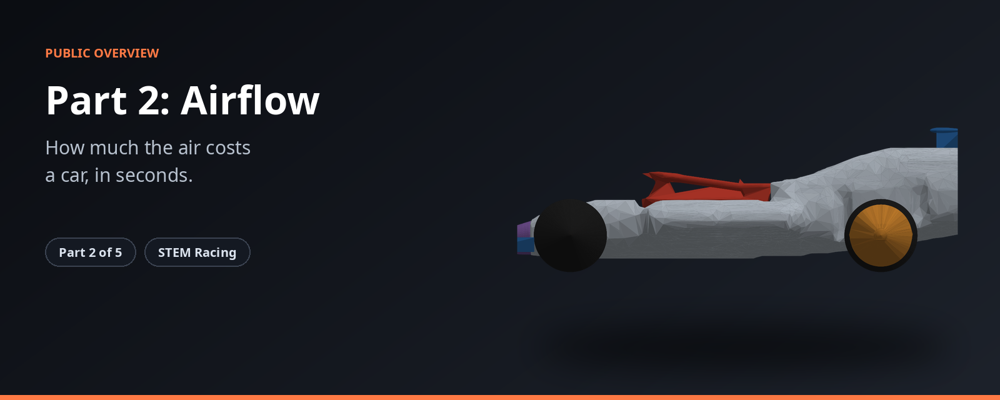
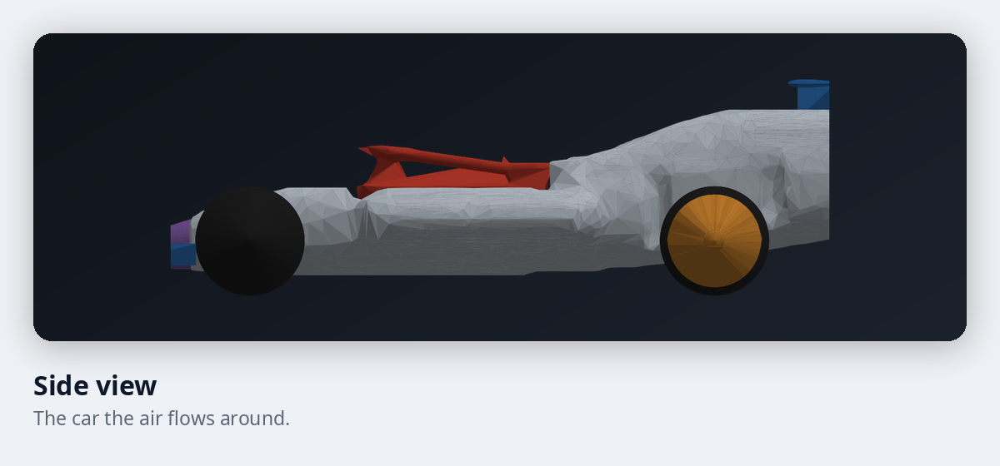
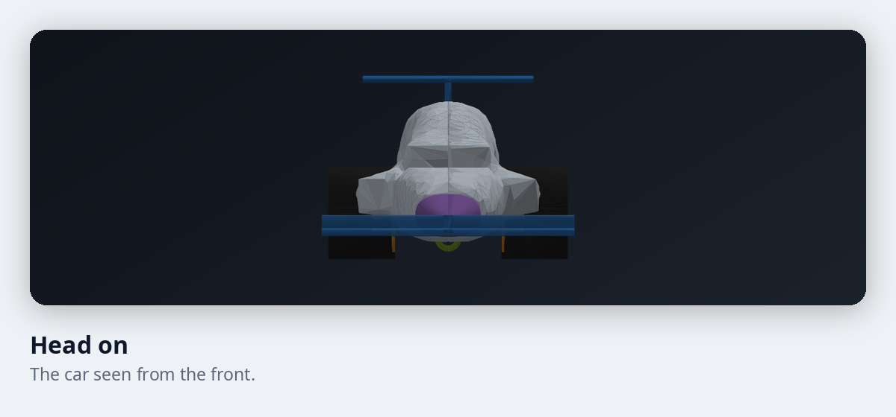

# STEM Racing, Part 2: Airflow and race time

**How much the air costs a car, in seconds.**

Part 2 measures how hard the air pushes back on the car, and turns that into time on the track.

| | |
|---|---|
| **Where it fits** | Part 2 of 5 in the STEM Racing toolkit |
| **What you get** | A drag figure and what it means for race time. |
| **Built for** | Student teams and their mentors |

## What it does

| Feature | What it gives you |
|---|---|
| Drag and lift | Measures how hard the air pushes back on the car, and how much it pushes down or up. |
| Race time | Turns the drag into seconds on the track, using the weight of the car. |
| Trust checks | Every result comes with a check on how steady the numbers are. |
| Quick and detailed runs | Quick runs for comparing ideas, and slower, more detailed runs for final answers. |

## A look at the car

<table>
<tr>
<td width="50%"></td>
<td width="50%"></td>
</tr>
</table>

These pictures are real output from the toolkit.

## How it fits

Part 2 tells the other parts what a design costs in the air. The full toolkit has five parts. See the [overview of the whole toolkit](https://github.com/Shashanksaraswat123939/stem-racing-overview).

| Part | Page |
|---|---|
| 1 | [Body](https://github.com/Shashanksaraswat123939/part1-overview) |
| 2 | [Airflow and race time](https://github.com/Shashanksaraswat123939/part2-overview) |
| 3 | [Connections](https://github.com/Shashanksaraswat123939/part3-overview) |
| 4 | [Components](https://github.com/Shashanksaraswat123939/part4-overview) |
| 5 | [Design advisor](https://github.com/Shashanksaraswat123939/part5-overview) |

## Status

| | |
|---|---|
| Project | Active |
| Source code | Private |
| This repository | Overview only, with no code |

## Credits

Made by [@Shashanksaraswat123939](https://github.com/Shashanksaraswat123939) and [@mxnviir](https://github.com/mxnviir).

## Rights

This page is a public overview of a private project. It contains no source code and does not describe how the project is built.

All rights reserved. You are welcome to read this page and share the link. You may not copy, reproduce or recreate the project from this material, and you may not use it to train, prompt or instruct automated systems to produce a copy. See the [LICENSE](LICENSE) file.
